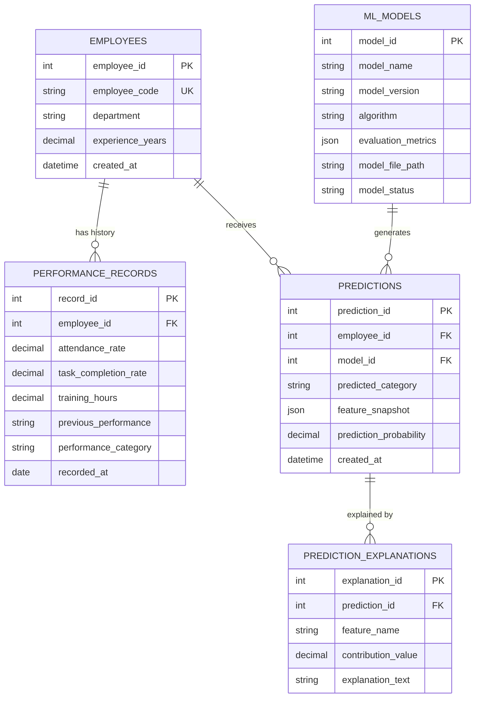

# Backend Schema & Database Specifications

## Employee Performance Analytics and Explainable Prediction System

**Course**: Computer Science & Engineering (3rd Year Mini Project)  
**Author**: Girish S  
**Database Engines Supported**: SQLite 3 (Default local) & MySQL 8.0  
**SQL Script**: [`sql/schema.sql`](file:///c:/Users/giris/Downloads/mini%20project%20employee%20performance%20reivew%20system/sql/schema.sql)  
**Python Manager**: [`src/database.py`](file:///c:/Users/giris/Downloads/mini%20project%20employee%20performance%20reivew%20system/src/database.py)  

---

## 1. Backend Architecture & Data Flow

```
+-------------------------------------------------------------+
|                 Streamlit Dashboard Frontend                |
|           (Upload CSV, Run Prediction, View Logs)           |
+-------------------------------------------------------------+
                               │
                               ▼
+-------------------------------------------------------------+
|                     Python Business Layer                   |
|          Validation, ML Pipeline, Explainability            |
+-------------------------------------------------------------+
                               │
                               ▼
+-------------------------------------------------------------+
|                   Relational Database Layer                 |
|             (SQLite / MySQL 8.0 - 5 Core Tables)            |
+-------------------------------------------------------------+
```

---

## 2. Five Core Database Tables

| Table Name | Description | Key Attributes |
|---|---|---|
| `employees` | Basic employee details | `employee_id`, `employee_code`, `department`, `experience_years` |
| `performance_records` | Work metrics & historical ratings | `record_id`, `employee_id`, `attendance_rate`, `task_completion_rate`, `training_hours`, `performance_category` |
| `ml_models` | Model metadata & evaluation metrics | `model_id`, `model_name`, `model_version`, `algorithm`, `evaluation_metrics` (JSON) |
| `predictions` | Logged predictions & feature snapshots | `prediction_id`, `employee_id`, `model_id`, `predicted_category`, `feature_snapshot` (JSON) |
| `prediction_explanations` | Feature impact contributions | `explanation_id`, `prediction_id`, `feature_name`, `contribution_value`, `explanation_text` |

---

## 3. Entity Relationship (ER) Diagram



---

## 4. Key SQL Audit Queries

### Retrieve Employee Performance History
```sql
SELECT
    e.employee_code,
    e.department,
    p.attendance_rate,
    p.task_completion_rate,
    p.training_hours,
    p.performance_category
FROM employees e
JOIN performance_records p ON e.employee_id = p.employee_id
ORDER BY p.recorded_at DESC;
```

### Retrieve Logged Predictions with Model Details
```sql
SELECT
    p.prediction_id,
    COALESCE(e.employee_code, 'Custom Input') AS employee_code,
    p.predicted_category,
    m.model_name,
    m.algorithm,
    p.created_at
FROM predictions p
LEFT JOIN employees e ON p.employee_id = e.employee_id
JOIN ml_models m ON p.model_id = m.model_id
ORDER BY p.created_at DESC;
```
