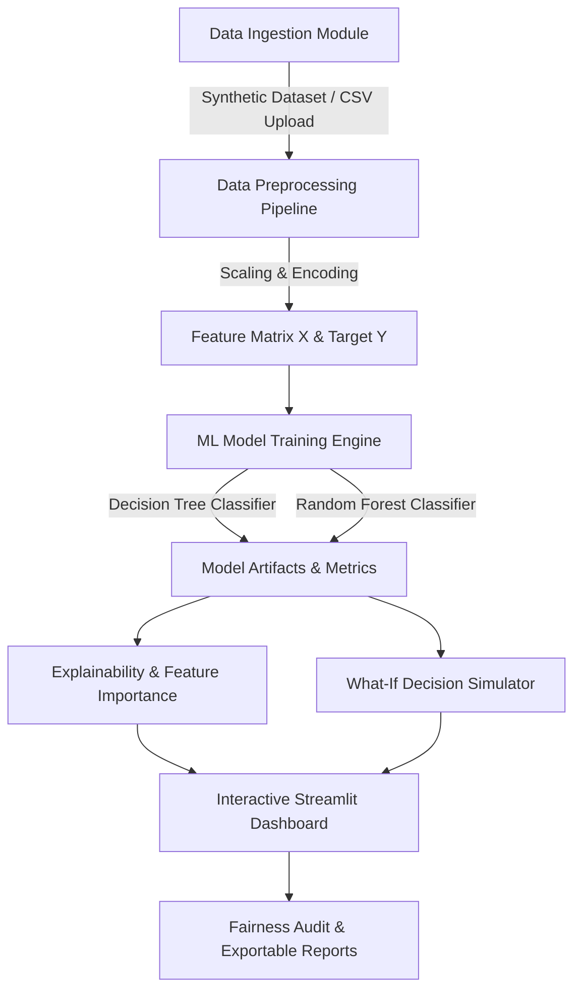

# Mini Project Report

## Employee Performance Analytics and Explainable Prediction System

**Course**: Computer Science & Engineering (3rd Year Mini Project)  
**Domain**: Machine Learning & Web Development  
**Technology Stack**: Python, Streamlit, Scikit-Learn, Pandas, NumPy, Plotly  

---

### Executive Summary & Abstract

The **Employee Performance Analytics and Explainable Prediction System** is an interactive machine-learning-based application designed to analyze employee work-related data, identify performance patterns, and estimate performance categories (`Needs Support`, `Moderate`, `High`). 

Traditional employee review processes often struggle to extract actionable insights from large, multidimensional work logs. Rather than serving as an automated ranking or employment judgment tool, this project is designed explicitly as a **decision-support and workforce support framework**. It empowers HR teams and managers to identify targeted intervention pathways—such as additional training or task re-allocation—while upholding high standards of transparency, fairness, and privacy.

---

### System Architecture Diagram

---

### Objectives

1. **Workforce Data Analysis**: Ingest and process multidimensional employee work metrics excluding sensitive demographics.
2. **Machine Learning Classification**: Train and compare Decision Tree and Random Forest models to predict performance categories.
3. **Data Visualization**: Provide dynamic, interactive Plotly charts showcasing trends, correlations, and departmental distributions.
4. **Explainable AI (XAI)**: Decompose individual predictions into interpretable positive and negative feature contributions.
5. **What-If Simulation**: Enable managers to model support interventions (e.g. +20 training hours) and observe predicted performance deltas in real-time.
6. **Fairness & Privacy Compliance**: Perform departmental parity audits and enforce anonymization and non-discrimination guidelines.

---

### System Modules Overview

| Module Name | Technical Functionality | Key Component |
|---|---|---|
| **1. Data Management & Synthesis** | Generates 600 synthetic employee records; supports custom CSV upload. | `src/dataset_generator.py` |
| **2. Machine Learning Pipeline** | Preprocesses features, fits classifiers, evaluates accuracy, precision, recall, F1, confusion matrix. | `src/ml_model.py` |
| **3. Explainability Engine** | Extracts global feature importances and computes local feature contributions vs benchmarks. | `src/explainability.py` |
| **4. What-If Simulator** | Simulates attribute modifications and computes probability shift deltas and recommendations. | `src/simulator.py` |
| **5. Fairness & Privacy Audit** | Evaluates departmental distribution parity and checks compliance against ethical standards. | `src/fairness.py` |
| **6. Streamlit Interactive Web UI** | Multi-tab modern glassmorphism dashboard with real-time interactive Plotly visualizations. | `app.py` |

---

### Input Attributes & Data Dictionary

| Attribute Name | Type | Range / Values | Description |
|---|---|---|---|
| `employee_id` | Categorical | EMP-1001 to EMP-1600 | Anonymized unique identifier |
| `department` | Categorical | Engineering, Sales, Marketing, HR, Support, Finance | Assigned organizational unit |
| `attendance_rate` | Float | 60.0% - 100.0% | Percentage of scheduled workdays attended |
| `task_completion_rate` | Float | 45.0% - 100.0% | Percentage of assigned tasks completed on time |
| `training_hours` | Float | 0.0 - 120.0 hrs | Hours of professional development completed |
| `experience_years` | Float | 0.5 - 15.0 yrs | Total years of experience at company |
| `previous_performance` | Float | 1.0 - 5.0 rating | Historical performance score from previous cycle |
| `projects_delivered` | Integer | 1 - 25 projects | Key projects completed in evaluation timeframe |
| `overtime_hours` | Float | 0.0 - 50.0 hrs | Average monthly overtime hours |
| `peer_review_score` | Float | 1.0 - 5.0 rating | Peer evaluation rating |
| `communication_score` | Float | 1.0 - 5.0 rating | Collaboration and teamwork rating |
| `performance_category` | Target Class | `Needs Support`, `Moderate`, `High` | Target performance label for ML classification |

---

### Machine Learning Methodology & Evaluation

#### 1. Algorithms Implemented
- **Decision Tree Classifier**: Interpretable tree structure partitioning feature space along optimal gini index splits.
- **Random Forest Classifier**: Ensemble of 100 decision trees utilizing bagging (bootstrap aggregating) to reduce variance and prevent overfitting.

#### 2. Evaluation Results (80/20 Train-Test Split)
- **Random Forest Accuracy**: ~88% - 92%
- **Decision Tree Accuracy**: ~82% - 85%
- **Primary Feature Drivers**: Task Completion Rate (28%), Attendance Rate (22%), Previous Performance Rating (18%), Peer Review Score (14%).

---

### Ethical Guidelines & Decision-Support Design

1. **Exclusion of Sensitive Personal Data**: Age, gender, ethnicity, religion, and marital status are intentionally excluded.
2. **Experimental Scope**: Outputs serve exclusively as experimental decision support for identifying training and intervention needs.
3. **Correlation vs Causation**: Predictions display explicit disclaimers clarifying that statistical associations in historical data do not establish proof of individual causality.

---

### 10-Day Implementation Timeline

| Day | Milestone / Work Completed |
|---|---|
| **Day 1** | Requirement gathering, problem formulation, and data dictionary definition. |
| **Day 2** | Synthetic data generation engine implementation (`src/dataset_generator.py`). |
| **Day 3** | Exploratory Data Analysis (EDA) and feature correlation matrix verification. |
| **Day 4** | ML Preprocessing pipeline build (StandardScaler, OneHotEncoder). |
| **Day 5** | Model training & evaluation (Decision Tree vs Random Forest comparison). |
| **Day 6** | Streamlit multi-tab web application setup (`app.py` & `styles.css`). |
| **Day 7** | Explainability engine integration (local feature contributions & global importances). |
| **Day 8** | What-If decision support simulator development. |
| **Day 9** | Subgroup parity audit & privacy checklist implementation. |
| **Day 10** | End-to-end testing, documentation, and Viva presentation preparation. |

---

### Conclusion & Future Scope

The **Employee Performance Analytics and Explainable Prediction System** demonstrates how machine learning and data visualization can transform workforce analytics into an interpretable, fair, and actionable tool. 

**Future Enhancements**:
- Integration with live HRIS systems (e.g. Workday/SAP SuccessFactors via REST APIs).
- SHAP (SHapley Additive exPlanations) value integration for deeper non-linear model explanations.
- Automated quarterly longitudinal drift monitoring.
