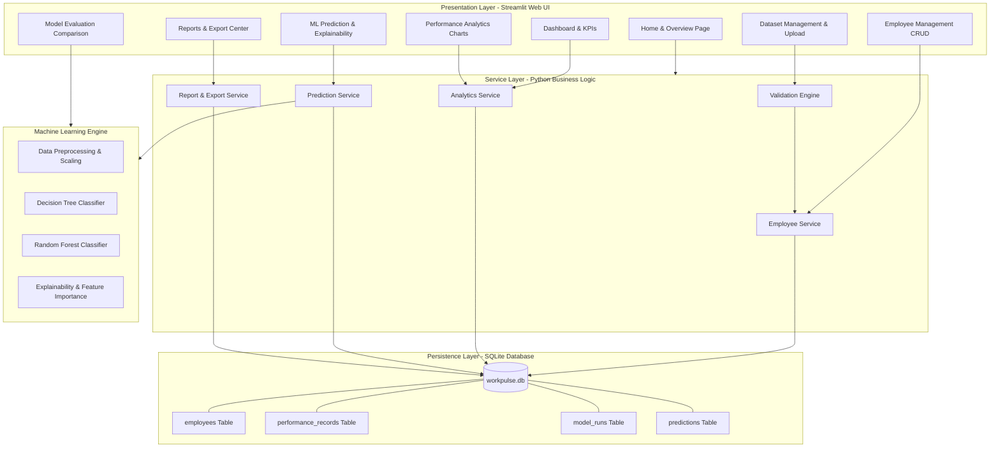
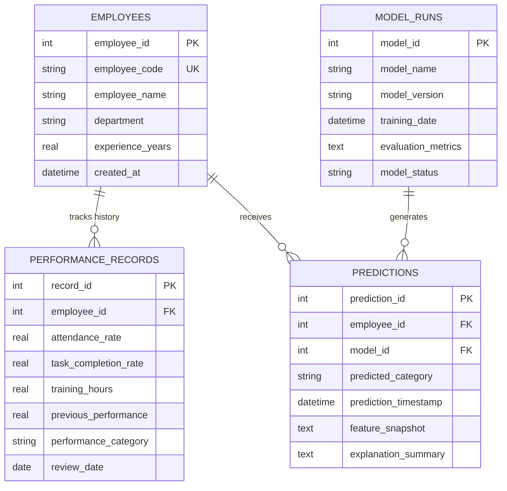
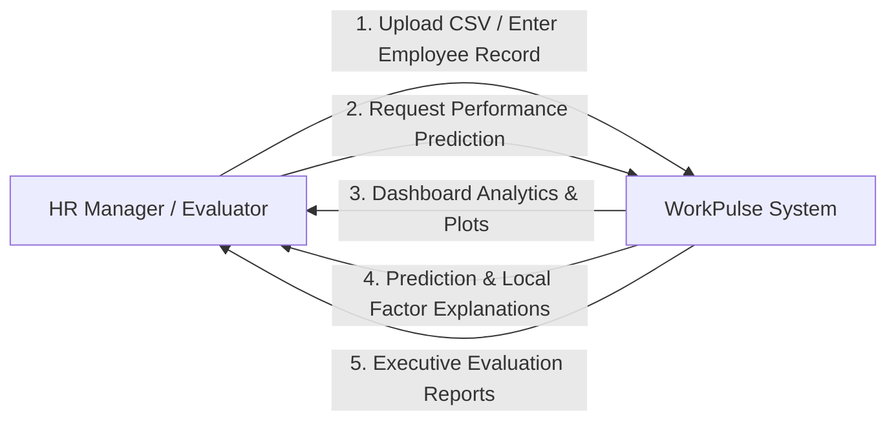
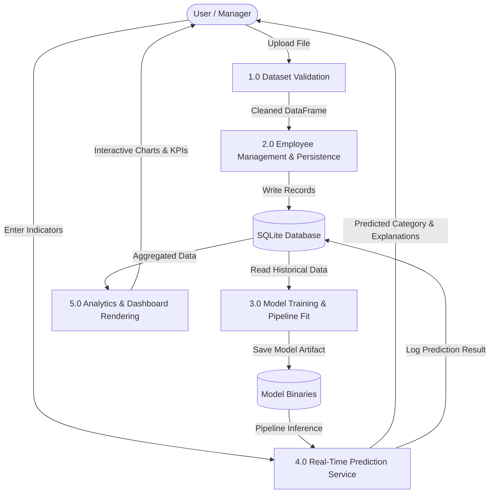

# System Architecture & Technical Design

## WorkPulse – Employee Performance Review System

This document outlines the software architecture, relational database schema, Entity Relationship (ER) model, and data flow diagrams for **WorkPulse**.

---

### 1. High-Level System Architecture

---

### 2. Entity Relationship (ER) Diagram

---

### 3. Data Flow Diagrams (DFD)

#### DFD Level 0 (Context Diagram)

#### DFD Level 1 (Functional Decomposition)

---

### 4. Machine Learning Pipeline Architecture
1. **Feature Separation**: Numerical features (`attendance_rate`, `task_completion_rate`, `training_hours`, `experience_years`, `previous_performance`) are separated from categorical features (`department`).
2. **Preprocessing**:
   - Numerical columns are standardized using zero-mean unit-variance z-score normalization ($z = \frac{x - \mu}{\sigma}$).
   - Categorical columns are one-hot encoded into binary indicator vectors.
3. **Training & Evaluation**:
   - Stratified train-test split (80% training, 20% held-out test).
   - Training fits Decision Tree and Random Forest classifiers.
   - Evaluates test accuracy, precision, recall, F1-score, and confusion matrix.
4. **Explainability**:
   - Global: Gini importance reduction across tree nodes.
   - Local: Quantifies deviation of employee metrics from population averages weighted by model importance.
